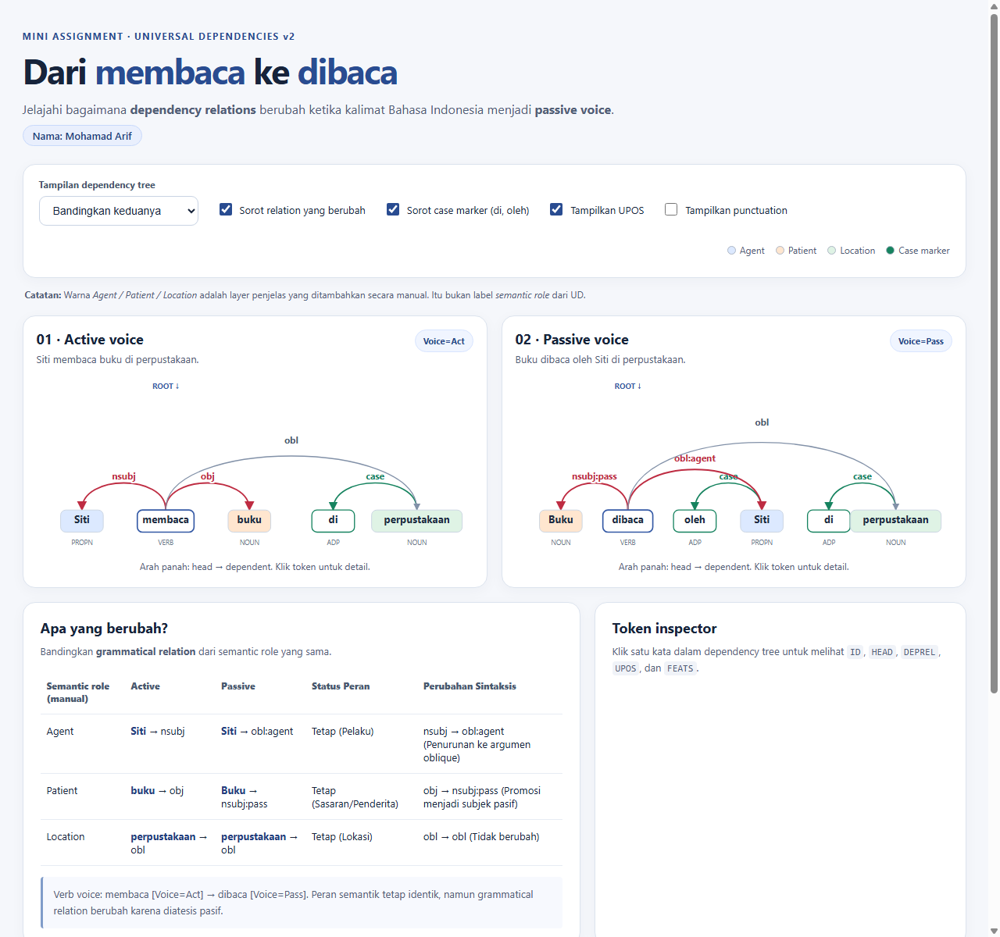

# Laporan Mini Assignment — Universal Dependencies Bahasa Indonesia

**Nama:** Mohamad Arif  
**Bentuk Pengerjaan:** Individu  
**Kelas:** Pengantar NLP / Computational Linguistics  
**Tanggal:** 28 Oktober 2026  

---

## A. Ringkasan Hasil

Visualisasi *dependency tree* interaktif ini berhasil dibangun untuk merepresentasikan dan membandingkan struktur sintaksis kalimat aktif (*"Siti membaca buku di perpustakaan."*) dan kalimat pasif (*"Buku dibaca oleh Siti di perpustakaan."*) berbasis skema Universal Dependencies v2 (UD v2). Melalui pemetaan visual arah *head* ke *dependent*, penanda peran semantik, dan inspektur token, visualisasi ini memperlihatkan secara gamblang bagaimana relasi gramatikal (*grammatical relations*) berubah secara teratur saat terjadi perubahan diatesis (*voice*), sementara peran semantik (*semantic roles*) partisipan tetap stabil. Aplikasi web ini dibangun murni menggunakan HTML, CSS, dan JavaScript SVG tanpa ketergantungan pustaka eksternal.

---

## B. Perbandingan *Active–Passive Voice*

| Semantic role (interpretasi manual) | Active: token + `DEPREL` | Passive: token + `DEPREL` | Apa yang berubah? |
|---|---|---|---|
| **Agent** (Pelaku aksi) | `Siti` → `nsubj` | `Siti` → `obl:agent` | Mengalami penurunan (*demotion*) dari subjek nominal klausa inti (*core argument*) menjadi argumen miring (*oblique argument*) dengan preposisi pemarkah kasus `oleh` (`case`). |
| **Patient** (Sasaran aksi) | `buku` → `obj` | `Buku` → `nsubj:pass` | Mengalami kenaikan/promosi (*passive promotion*) dari objek langsung (*direct object*) menjadi subjek gramatikal pasif (*passive nominal subject*). |
| **Location** (Keterangan tempat) | `perpustakaan` → `obl` | `perpustakaan` → `obl` | Tidak mengalami perubahan relasi sintaksis maupun peran semantik; tetap berfungsi sebagai argumen miring (*oblique*) dengan pemarkah kasus `di` (`case`). |

---

## C. Jawaban Analisis

### C1. Mengapa `buku` berubah dari `obj` menjadi `nsubj:pass`?
Pada kalimat aktif (*"Siti membaca buku..."*), verba `membaca` adalah predikat aktif transitif yang menuntut objek langsung (`obj`) sebagai argumen inti penderita. Ketika dikonversi menjadi kalimat pasif (*"Buku dibaca..."*), terjadi proses pasivisasi (*passivization/passive promotion*). Morfologi verba beralih menjadi pasif (`dibaca`, ditandai fitur `Voice=Pass`), sehingga argumen *patient* (`buku`) dipromosikan mengisi fungsi subjek gramatikal utama. Universal Dependencies menandainya dengan subtipe `nsubj:pass` (*passive nominal subject*) untuk mengindikasikan secara eksplisit bahwa nomina tersebut berposisi sebagai subjek dari klausa pasif, bukan klausa aktif.

### C2. Mengapa `Siti` berubah dari `nsubj` menjadi `obl:agent`?
Universal Dependencies memisahkan struktur sintaksis lahiriah dari peran semantik. Meskipun peran semantik Siti tetap sebagai pelaku (*agent*), posisi subjek sintaksis pada kalimat pasif telah diambil alih oleh `Buku`. Akibatnya, pelaku diturunkan (*demoted*) status gramatikalnya menjadi konstituen periferal/miring (*oblique modifier*). Skema UD v2 menggunakan label subtipe khusus `obl:agent` untuk mendokumentasikan argumen miring yang memegang peran pelaku pada konstruksi pasif, dengan kata `oleh` sebagai relasi `case`.

### C3. Mengapa `di` di “di perpustakaan” menjadi token `case`, tetapi `di-` pada “dibaca” tidak menjadi node sintaksis tersendiri?
Perbedaan ini berakar pada prinsip pemisahan antara leksem sintaksis bebas dan morfem terikat. Kata `di` pada *"di perpustakaan"* adalah leksem preposisi mandiri (`UPOS=ADP`), sehingga memiliki nomor `ID` tersendiri dan diberi relasi `case` terhadap kata bendanya (`perpustakaan`). Sebaliknya, `di-` pada *"dibaca"* adalah afiks derivasi/infleksi pembentuk verba pasif yang menyatu dalam satu kata utuh. Berdasarkan prinsip *lexicalism* (§2.1), graf ketergantungan UD hanya menghubungkan kata-kata utuh (*whole words*), bukan morfem afiks. Informasi pasif dikodekan sebagai fitur morfologis (`FEATS=Voice=Pass`) pada simpul verba `dibaca`, bukan dipecah menjadi node tersendiri.

### C4. Bagaimana temuan Anda terhubung dengan bagian paper (de Marneffe et al., 2015)?
Temuan di atas secara komprehensif mengonfirmasi empat prinsip utama dalam paper:
1. **§2.1 (Lexicalism):** Verba `dibaca` dipertahankan sebagai satu kesatuan kata (*whole syntactic word*), membuktikan bahwa afiks infleksional/derivatif tidak dipecah menjadi node tersendiri.
2. **§2.2 (Dependents of clausal predicates):** Memperlihatkan alternasi argumen inti klausa (*core clausal arguments*), di mana transformasi pasif mengubah `nsubj` dan `obj` menjadi `nsubj:pass` dan argumen non-inti `obl:agent`.
3. **§2.5 (Treatment of prepositions and case marking):** UD menganut prinsip *content-word head*; kata benda leksikal (`perpustakaan` dan `Siti`) diperlakukan sebagai *head*, sedangkan kata tugas/preposisi penanda kasus (`di` dan `oleh`) diperlakukan sebagai *dependent* berlabel `case`.
4. **§2.7 (Language-particular relations):** Menjelaskan rasionalisasi pemakaian *subtypes* berkolon (`nsubj:pass` dan `obl:agent`) yang memberikan diferensiasi gramatikal yang lebih kaya tanpa merusak taksonomi relasi dasar lintas bahasa.

---

## D. Modifikasi Kode (Task D & Bonus Challenge)

### 1. Fitur yang Ditambahkan
Untuk memenuhi kriteria Task D dan meraih bonus maksimal (+10 poin):
1. **Penyorotan Khusus Case Markers (`di`, `oleh`):** Menambahkan opsi *checkbox* `Sorot case marker (di, oleh)`. Ketika aktif, relasi `case` diwarnai hijau zamrud (`#16835f`), panah menggunakan penanda `arrow-case`, dan *Token Inspector* memberikan penjelasan akademis mengenai prinsip *content-word head* (§2.5).
2. **Toggle Penampil UPOS:** Menambahkan kontrol *checkbox* untuk menampilkan atau menyembunyikan label *Universal Part-of-Speech* (`UPOS`) di bawah tiap simpul kata, mempermudah fokus visual pembaca.
3. **Penyempurnaan Comparison Table:** Menambahkan dua kolom baru pada tabel komparasi, yaitu **Status Peran** (menegaskan status kestabilan semantik *Agent, Patient, Location*) dan **Perubahan Sintaksis** (penjelasan pergeseran relasi gramatikal).
4. **Panel Bonus Challenge "di vs di-":** Menambahkan kartu analitis responsif di bagian bawah antarmuka yang mengupas tuntas perbedaan preposisi leksikal versus afiks pasif berlandaskan §2.1 (*Lexicalism*) dan §2.5 (*Case Marking*).

### 2. File dan Bagian yang Diubah
- **`index.html`:** Menambahkan elemen kontrol input (`#highlightCase`, `#showUpos`), memperbarui struktur tabel `<thead>`, menambahkan titik legenda baru, dan menambahkan `<section class="panel bonus-card">`.
- **`style.css`:** Menambahkan aturan CSS `.edge.case-edge`, `.edge-label.case-label`, `.node.is-case`, `.node-pos.hidden`, `.inspector-note`, serta *layout grid* untuk `.bonus-card`.
- **`app.js`:** 
  - Memperbarui `renderTree` untuk menerima parameter status visibilitas UPOS dan penyorotan *case markers*.
  - Menambahkan *SVG marker* baru `#arrow-case` bertinta `#16835f`.
  - Mengembangkan fungsi `inspectToken` agar menampilkan catatan analitis interaktif saat token bertipe `case` atau berlema `baca` diklik.
  - Memperluas fungsi `renderComparison` untuk merender 5 kolom komparasi menyeluruh.

### 3. Cuplikan Kode Modifikasi

```javascript
// Cuplikan dari app.js: Logika pewarnaan khusus case markers
const isCase = highlightCase && t.deprel === "case";
if (changed) {
  edgeClass = "edge changed";
  markerId = "url(#arrow-change)";
  labelClass = "edge-label changed";
} else if (isCase) {
  edgeClass = "edge case-edge";
  markerId = "url(#arrow-case)";
  labelClass = "edge-label case-label";
}
```

```javascript
// Cuplikan dari app.js: Analisis interaktif pada Token Inspector
if (token.deprel === "case") {
  const note = document.createElement("div");
  note.className = "inspector-note";
  note.innerHTML = `<strong>💡 Catatan Case Marker (§2.5):</strong> '<code>${token.form}</code>' adalah preposisi (${token.upos}) yang menandai relasi kasus/oblique. Dalam UD, kata benda utama (<em>${headWord?.form || "head"}</em>) menjadi head, dan preposisi adalah dependent-nya.`;
  target.appendChild(note);
}
```

### 4. Hasil Pengujian
1. **Validasi Sintaksis Data CoNLL-U:**
   Perintah `python validate_conllu.py data/contoh_kalimat.conllu` menghasilkan status `OK` untuk kedua kalimat tanpa siklus maupun referensi `HEAD` ilegal.
2. **Pengujian Fungsionalitas Antarmuka:**
   - Server web lokal `http://localhost:8000/` berhasil menyajikan seluruh elemen secara responsif.
   - Pilihan seleksi tampilan (Bandingkan / Aktif saja / Pasif saja) berjalan mulus.
   - Fitur klik pada setiap simpul berhasil memperbarui isi *Token Inspector* secara *real-time*.
   - Tombol centang *Sorot case marker* dan *Tampilkan UPOS* terbukti bekerja secara independen.

### 5. Tangkapan Layar (Screenshot)
Tangkapan layar antarmuka aplikasi tersimpan pada file `screenshot.png` di direktori proyek:



---

## E. Refleksi

Hal paling berharga yang dipahami melalui mini assignment ini adalah kejelasan batas antara **struktur sintaksis formal** dan **makna semantis**. Sering kali kita mencampuradukkan konsep "subjek" dengan "pelaku". Melalui visualisasi Universal Dependencies ini, terlihat secara presisi bahwa proses pasivisasi dalam Bahasa Indonesia adalah rekonfigurasi hierarki sintaksis permukaan: peran semantik (*semantic roles*) partisipan peristiwa tetap statis, tetapi relasi gramatikalnya dimutasi demi menggeser sudut pandang topik/fokus tuturan. Selain itu, prinsip *content-word head* pada preposisi memberikan wawasan baru bahwa kata yang bermakna substantif (seperti nomina) selalu menjadi inti yang menaungi partikel tugas di sekitarnya.

---

## F. Referensi

- de Marneffe, M. C., Dozat, T., Silveira, N., Haverinen, K., Ginter, F., Nivre, J., & Manning, C. D. (2015 revision). [*Universal Dependencies: A cross-linguistic typology*](https://nlp.stanford.edu/~manning/papers/USD_LREC14_UD_revision.pdf).
- Universal Dependencies Consortium. [*Universal Dependencies v2 Guidelines & Relations*](https://universaldependencies.org/u/dep/index.html).
- Universal Dependencies Consortium. [*CoNLL-U Format Specification*](https://universaldependencies.org/format.html).
- Universal Dependencies. [*Indonesian-GSD Treebank Documentation*](https://universaldependencies.org/treebanks/id_gsd/index.html).
- Universal Dependencies. [*Indonesian `nsubj:pass`*](https://universaldependencies.org/id/dep/nsubj-pass.html) & [*Indonesian `obl:agent`*](https://universaldependencies.org/id/dep/obl-agent.html).
